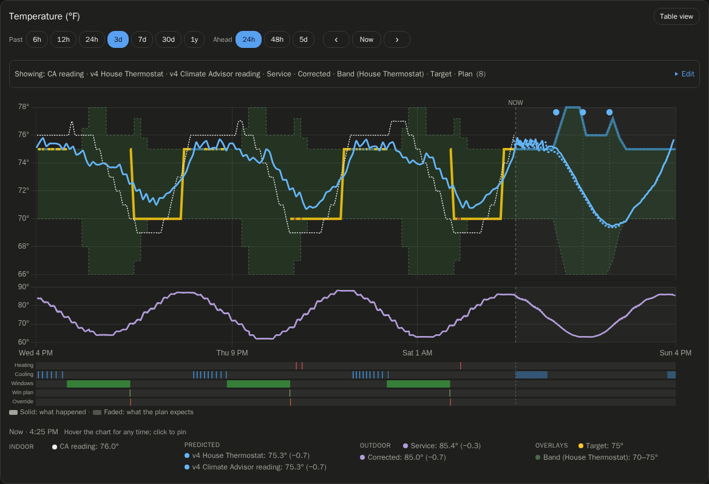
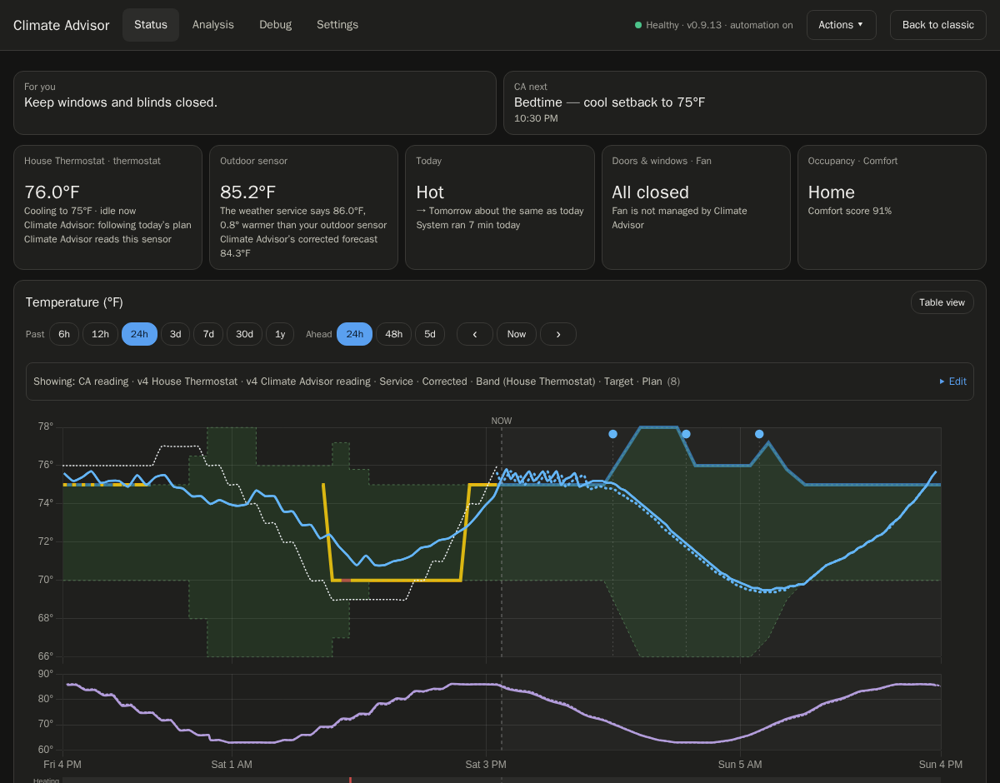
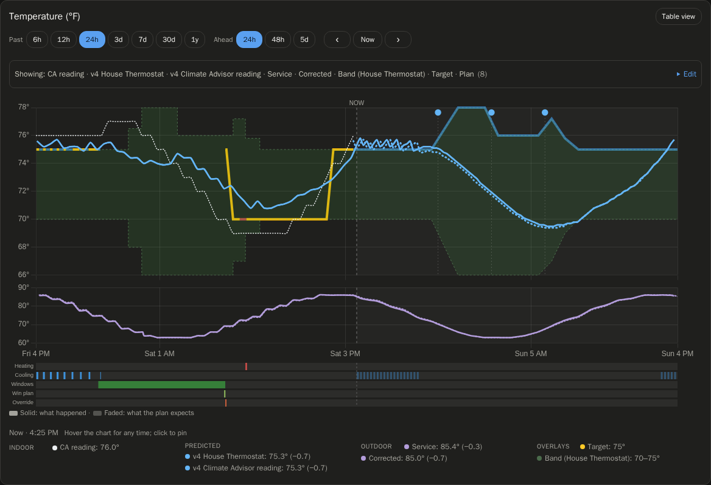
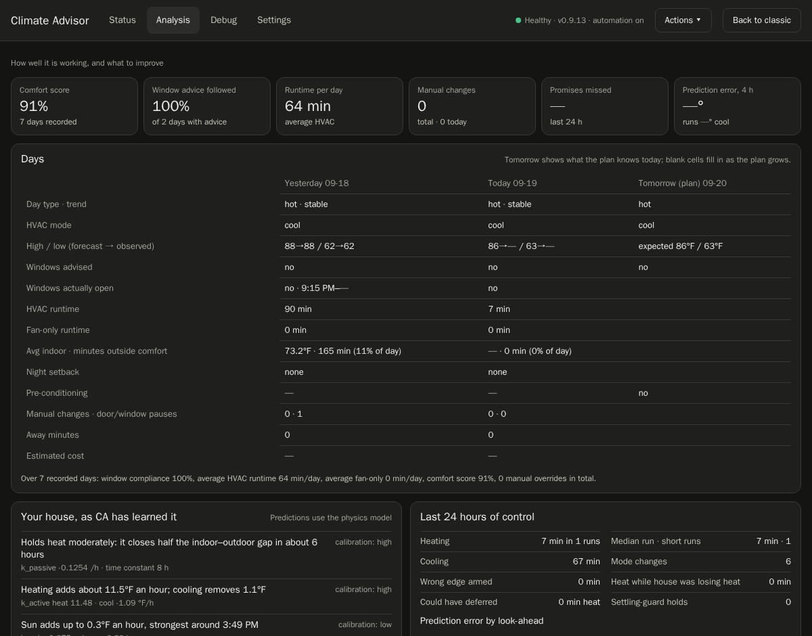

# Climate Advisor for Home Assistant

A Home Assistant integration that runs your thermostat from the weather forecast, your schedule, occupancy and your door/window sensors, so the house stays comfortable without wasted heating or cooling. It learns how your home and thermostat behave over time.

**Requires Home Assistant 2026.3 or newer.** Available in the [HACS](https://hacs.xyz) default store.

*Screenshots show an example house (simulated), not a real home.*

| Temperature Forecast | Current Status |
|---|---|
|  |  |

| 24-hour View | Analysis |
|---|---|
|  |  |

## What it does

- **Plans each day from the forecast.** Each morning it classifies the day (hot / warm / mild / cool / cold) and the trend into tomorrow, then sends a short briefing with what it will do and what you can do (open or close windows).
- **Holds a comfort band, not a schedule of writes.** It sets one heat or cool setpoint at the edge of your comfort range and lets the thermostat hold it. It switches between heat and cool as the house moves, and adjusts at wake-up, bedtime and when you leave or return.
- **Respects your changes.** A change you make at the thermostat is kept for a grace period (30 min by default) before Climate Advisor resumes its plan.
- **Handles doors and windows.** Once a door or window has been open past its delay (10 min by default), heating and cooling pause (or ventilation starts, see below). They resume when it closes. A sensor that stops reporting holds the pause rather than counting as closed.
- **Uses outside air.** When outdoor air helps, it runs natural ventilation through a whole-house fan or the thermostat's blower instead of the AC.
- **Optional extras:**
  - a bedroom sensor at night (see below);
  - away / vacation / guest occupancy toggles;
  - time-of-use pre-conditioning ahead of high-cost periods (each schedule can be limited to changing only the cooling or only the heating setpoint, and switched on and off by an entity such as a peak-season helper);
  - a daily energy cost estimate: enter your energy rate and the heating and cooling power, and each day's record gets an estimated cost (left blank, nothing is assumed and the cost shows "—");
  - an optional AI Investigator that runs on the AI provider you already use in Home Assistant (OpenAI, Google, Anthropic, Ollama, OpenRouter and others); see [AI Investigator](#ai-investigator).
- **Learns your house, then plans with it.** A prediction engine learns how fast your home heats, cools, leaks heat and warms in the sun, and forecasts the indoor temperature ahead. The engine you choose (v4 by default) times pre-heating and pre-cooling, the ceiling guard, setbacks and the window close time; see [Prediction engines](#prediction-engines). Climate Advisor also learns your thermostat's own swing, and after two weeks of data it starts offering suggestions.
- **One plan behind everything you read.** The "Next 24 hours" list, Your Next Action, Next Automation, the briefing (including its "Today's Steps") and the Analysis tab's plan for tomorrow all read the same plan, so they never disagree about when to open or close the windows or what Climate Advisor does next.
- **Tonight in the bedroom (advice only).** Each evening it compares keeping the windows closed, opening them for a while, or running the whole-house or HVAC fan, and recommends one. It never opens a window or starts a fan for this advice. Predicted bedroom temperatures appear only once the v4 bedroom model is confident; until then the advice is in words.
- **Watches itself.** It warns you when the thermostat, weather source or a sensor stops responding. It also checks its own behaviour against a set of household promises (for example, "never undo your manual change early"); any misses show in the Analysis tab and in the diagnostics.
- **Observe-only mode.** Turn the automation switch off and Climate Advisor keeps planning and reporting but sends no commands.

### Prediction engines

Climate Advisor ships two prediction engines and picks the one you choose, per zone, under **Configure → Learning & Behavior**:

- **Prediction engine** (default **v4**). Its forecast is the main prediction line on the Status chart and drives the "Next 24 hours" path. It also runs the house: it decides when the ceiling guard switches the AC on ahead of a warm afternoon, when the time-of-use pre-cool or pre-heat starts, how deep the bedtime setback is sized and when the window period closes.
- **Comparison engine** (default **none**). An optional second engine, drawn as a comparison line next to the main one. It never acts on the house. It must be different from the prediction engine.

Only the engines you pick run (v3's basic learning, such as your thermostat's swing, is always collected).

v4 fits a model of your house every night between 3:15 and 3:45 (a "thermal mass" for the walls and furniture, a line per room sensor, your thermostat's own on/off pattern and a correction for how far your weather forecast is usually off). v3 is the older engine, kept as an option.

**While the chosen engine is still learning** (the first days after switching, or no usable fit yet), Climate Advisor behaves exactly like a fresh install: default lead times and setbacks, and no early AC switch-on. It never borrows the other engine. The chart shows the plain schedule estimate with "Prediction: learning — showing the schedule estimate", and the note says Climate Advisor is using its default plan until the engine has learned your home. The log says so once, and again when the engine takes over.

**Prediction accuracy** (linked from the Analysis tab) shows how each engine has scored against what really happened, by sensor, how far ahead and over a range from 6 hours to a year. It is information only: nothing is hidden or switched on because of a score.

Details: [prediction-engines-spec](docs/prediction-engines-spec.md), [predictor-v4-spec](docs/predictor-v4-spec.md).

### Household rules

Rules 1 and 2 apply only with a whole-house fan. Rule 3 applies to every home with door/window sensors.

1. The whole-house fan never runs in a sealed house. With every door and window closed, it is stopped within 30 seconds, however it was turned on.
2. The whole-house fan and the heat/AC never run together, and your newest action wins. If both are ever found running, one of them is stopped within about 10 seconds, whatever the button timing.
3. No heating or cooling into a window open past its delay, unless you turned it on yourself.

A whole-house fan therefore **needs at least one door/window sensor**. Without one, setup warns you, and that configuration is not supported.

### Day types

| Day | Today's high (default) | Climate Advisor | You |
|---|---|---|---|
| Hot | 85°F+ | Cools, pre-cools overnight when it helps | Keep the house sealed, close blinds |
| Warm | 75–84°F | Holds the comfort band; ventilates when outside air helps | Open windows in the morning, close them when it warms |
| Mild | 60–74°F | Holds the comfort band | Open windows when the briefing says they help |
| Cool | 45–59°F | Heats | Keep closed |
| Cold | below 45°F | Heats, pre-heats ahead of colder days | Keep sealed |

The thresholds are adjustable. A trend of 5°F or more into tomorrow adjusts the overnight setback and pre-heating; 10°F or more adjusts them further.

### Fans

- **Fan mode:** disabled, whole-house fan, or HVAC fan (the thermostat's blower).
- **Whole-house fan:**
  - A separate state entity (`fan_state_entity`) can report the fan's real on/off state. With `fan_state_feedback` off (the default), Climate Advisor can't see the fan.
  - The optional QuietCool RF remote integration honours the wall remote's timer presses. It needs the [`gunkl/quietcool-house-fan`](https://github.com/gunkl/quietcool-house-fan) firmware; see [fan-remote-spec](docs/fan-remote-spec.md).

### Bedroom sensor at night

Set a **Sleep Indoor Temp Sensor** to keep the bedroom, not the hallway, on target while the sleep schedule is active. Climate Advisor raises the hallway setpoint a step at a time, at most 4°F (2°C) past your sleep temperature, so the furnace or AC actually runs for the bedroom. It steps back down once the bedroom is on target. The Status card and the chart show the extra degrees. Cooling works the same way but has only been tested in simulation.

## Installation

**HACS (recommended):** search for "Climate Advisor" in HACS, install it, and restart Home Assistant. Then go to **Settings → Devices & Services → Add Integration → Climate Advisor**.

**Manual:** copy `custom_components/climate_advisor` into `config/custom_components/`, restart, then add the integration as above.

HACS installs published releases (see the "released" badge above). The 0.9 line (new prediction engine, one plan behind every card, the new dashboard) is on `main` and published as pre-releases until it is marked the latest release; 0.8 fixes continue on the [`0.8.x`](https://github.com/gunkl/ClimateAdvisor/tree/0.8.x) branch.

### Removing Climate Advisor

1. Go to **Settings → Devices & Services → Climate Advisor** and delete each zone (**⋮ → Delete**). Deleting a zone also deletes its files in your `config` folder (state, learning, chart log, forecast and model archives, AI reports) and its Repairs cards. Your thermostat keeps whatever setpoint and mode it had last.
2. Remove the integration in HACS (**HACS → Climate Advisor → ⋮ → Remove**), or delete `config/custom_components/climate_advisor` if you installed it by hand.
3. Restart Home Assistant.

Turn your thermostat's own schedule back on if you turned it off for Climate Advisor (see [Thermostat requirements](#thermostat-requirements)).

### Upgrading to 0.9.4

- **The prediction engine becomes v4** on every zone (no migration step; you can switch back to v3 in Configure → Learning & Behavior). If a zone has no v4 model yet, its first fit starts from your recorded history within minutes of the restart, as soon as Climate Advisor's startup window (about 5 minutes) has ended. Until it lands the zone runs on the default plan described above, and v4 takes over at the next 30-minute cycle after the fit. A fit that finds too little usable history is retried, at most every 6 hours, and the nightly fit keeps going.
- **The new dashboard opens by default.** See [Dashboard](#dashboard).
- **Rolling back to 0.9.3** is safe: the learning file is untouched (and now ignores fields it does not recognise), and the new per-zone files are simply left on disk and ignored. The one loss: rolling back on the same day loses that day's in-progress daily record.

## Setup

The setup wizard asks for:

1. **Core:** weather entity, climate entity and notification service.
2. **Unit:** °F or °C. This applies to every displayed value and input.
3. **Setpoints:** comfort and setback for heat and cool, plus optional sleep heat and sleep cool. Each accepts 40–95°F (4–35°C). If a combination would make the heat and AC fight or settle somewhere odd, a warning appears next to the field; press Submit again to keep it. Separate vacation heating and cooling temperatures are in Options (blank = 3°F beyond away).
4. **Temperature sources:** indoor and outdoor, from the weather service, a sensor, an input number or the thermostat (indoor only).
5. **Doors/windows and fan:**
   - door/window sensors, their polarity and the open delay;
   - fan mode and fan entities.
6. **Occupancy:** optional home/away, vacation and guest toggles, each with a polarity setting.
7. **Schedule:**
   - zone name;
   - wake time (default 06:30), bedtime (22:30) and briefing time (06:00).

Everything is editable afterwards under **Configure**. The options there also cover:
- time-of-use schedules;
- notifications;
- **Temperature Sources:** **Thermostat Finer Sensor** (Auto by default). Many thermostats show whole degrees but also have a finer sensor on the same device; once it proves to be the same reading, Climate Advisor uses it (68.54°F instead of 69°F) and falls back to the thermostat's own reading if it goes missing or disagrees;
- **Learning & Behavior:** the prediction and comparison engines, **Prefer Savings Over Comfort**, adaptive pre-heat and setback, and the optional energy rate, heating power and cooling power for the cost estimate;
- **Sensors & Fan:** door/window sensors, the fan and the natural-ventilation soft start;
- day-type thresholds;
- AI settings, which apply to every zone (see [AI Investigator](#ai-investigator));
- GitHub settings, for submitting reports as issues.

### Thermostat requirements

Climate Advisor is the scheduler and the thermostat is the executor. Set the thermostat so it keeps Climate Advisor's commands:

- **Turn off built-in schedules and "smart" home/away features.** On an Ecobee, for example, turn off Smart Recovery.
- **Set holds to last until changed.** On an Ecobee: Hold Action → Until I change it.
- **Single-mode systems:** heat-only and cool-only thermostats work, with Climate Advisor using the one mode the device has. These setups are less tested than heat-and-cool systems.

### Supported devices

- **Tested:** Ecobee thermostats, through Home Assistant's Ecobee integration.
- **Not tested:** everything else. Climate Advisor works with Home Assistant entities, not with brands, so any `climate` entity that supports heat and/or cool modes and setting a target temperature should work. The same goes for any `weather` entity with a forecast, and any `fan` or `switch` entity for a whole-house fan. None of these has been tested yet. If you run Climate Advisor with something else, an issue saying whether it worked helps the next person.

### AI Investigator

The optional AI Investigator reads what Climate Advisor did and why, and writes a report in your Home Assistant language. It uses the AI provider you set up in Home Assistant, so Climate Advisor keeps no key of its own. With a local model such as Ollama, your house data stays at home.

1. **Add your AI provider to Home Assistant** under **Settings > Devices & services**, for example OpenAI, Google Generative AI, Anthropic, Ollama or OpenRouter, and give it an **AI Task** entity.
2. **Set its limits** in that integration's AI Task options:
   - max tokens at least **8192**, where the integration has this setting;
   - reasoning (thinking effort) at **medium**, where it has one;
   - for Ollama, a context window (`num_ctx`) of **32768**.

   A smaller limit can cut a report short, and on Anthropic and OpenAI the whole report is then lost. Climate Advisor checks these limits where it can and warns you before a run, but it never stops you.
3. **Choose it in Climate Advisor:** **Configure > AI settings**, pick the AI Task entity, or leave the field empty to use Home Assistant's preferred AI Task entity (**Settings > System > AI**). These settings apply to every zone.

The report appears all at once when it is ready. Climate Advisor no longer shows the cost of an AI Task run; your provider's account shows usage and spending.

**Already using Climate Advisor's built-in Claude?** It still works, but it is deprecated and will be removed in a later release. To move:

1. Add Home Assistant's **Anthropic** integration with your API key, then add an **AI Task** to it.
2. **Untick "Recommended model settings"** so you can set **max tokens to 8192** (the default is 3000, too small for a full report). Pick the same Claude model you use today and set thinking effort to **medium**.
3. In Climate Advisor's AI settings, choose the new `ai_task.*` entity. The deprecation notice in AI settings and in **Settings > Repairs** then clears.

Details: [ai-integration](docs/ai-integration.md), [moving from built-in Claude](docs/builtin-claude-deprecated.md).

### Multiple zones

Each thermostat is its own zone: a separate config entry with its own learning, thermal model, dashboard data and settings. The only thing shared between zones is the AI settings: they apply to the whole home, and saving them in one zone sets them in every zone.

To add a zone, run **Add Integration → Climate Advisor** again for the next thermostat. With two or more zones:
- the dashboard shows a zone selector;
- every service asks which zone it applies to.

See [multi-zone-spec](docs/multi-zone-spec.md).

### How data updates

- **Every 30 minutes**, each zone fetches the forecast, reclassifies the day and refreshes its plan and sensors.
- **Right away**, when one of the entities you picked in setup changes: the thermostat, a door or window sensor, a room sensor, occupancy or the fan.
- **At the briefing time** you set, the daily briefing is built and sent.

If an update fails, the zone's sensors show as unavailable until the next good update. The error is logged once, and so is the recovery.

**At startup a zone doesn't wait for its thermostat.** If the thermostat's own integration is still loading after a restart (a cloud thermostat, for example), the zone starts anyway and runs on fallbacks until the thermostat appears, rather than sitting in "retrying setup" (a deliberate choice, #1640).

### Known limitations

- **One thermostat per zone.** A home with several thermostats sets up one zone each.
- **The thermostat must follow commands.** Its own schedules and "smart" features have to be off (see [Thermostat requirements](#thermostat-requirements)).
- **Heat-only and cool-only systems** work but are less tested than heat-and-cool systems.
- **The AI Investigator needs an AI provider** set up in Home Assistant. A cloud provider sends your house data to that service; a local model such as Ollama keeps it at home. Everything else works without AI.
- **Predictions need history.** A new zone plans with default values until it has learned how your house heats and cools.
- **Home Assistant 2026.3 or later** is required.

## Entities

Each zone creates **21 sensors** and **1 switch**, grouped under a device named after the zone. Entity IDs come from the zone name, for example `sensor.living_room_day_type`. Existing entities keep the IDs they were created with.

**Diagnostic sensors** (Heat and Cool Threshold, Last Action Time and Reason, AI Status) appear under Diagnostic on the device page and are left out of auto-generated dashboards; they keep their history. **Trend** is disabled by default on new installs, because its value is also an attribute of Day Type: enable it on the device page if you want it as its own sensor. Existing installs keep it as it is.

| Entity | What it shows |
|---|---|
| Day Type, Trend | Today's classification and the trend into tomorrow |
| Daily Briefing | Today's briefing summary; the full text is in the attributes |
| Your Next Action | What you can do next, such as opening or closing windows |
| Next Automation Action, Next Automation Time | What Climate Advisor does next, and when |
| Status | Active, grace, override or paused |
| Target Temperature | The temperature the house is aiming for right now. While the thermostat is not Off this is the thermostat's own setpoint, so with Automation off (observe-only) it shows the setpoint your own controller set, not Climate Advisor's |
| Heat Threshold, Cool Threshold | The band Climate Advisor holds the house to right now: it heats below Heat Threshold and cools above Cool Threshold. They follow your comfort, sleep, away and vacation settings, Prefer Savings and time-of-use widening; the `context` attribute names which band is in force. Diagnostic sensors with history, in your unit. Same numbers as `ca_target_heat` / `ca_target_cool` in the [REST API](docs/rest-api.md) |
| Comfort Score | How much of the time the house stayed in range |
| Occupancy Mode | Home, away, vacation or guest |
| Last Action Time, Last Action Reason | The last thermostat change and why |
| Fan Status | Fan state, such as active, manual override or inactive |
| Contact Sensors | Door/window summary, with per-sensor detail |
| Indoor Temperature, Outdoor Temperature, Forecast High, Forecast Low | Current readings and today's forecast |
| AI Status | AI feature state and usage, the same in every zone. Cost is shown only for built-in Claude |
| **Automation** (switch) | Off means observe-only: no commands are sent |

## Services

Every service takes a **Zone** (`entry_id`), which you pick from the dropdown in the service-call UI.

| Service | Purpose |
|---|---|
| `climate_advisor.respond_to_suggestion` | Accept or dismiss a learning suggestion (`action`, `suggestion_key`) |
| `climate_advisor.force_reclassify` | Fetch the forecast again and reclassify today |
| `climate_advisor.resend_briefing` | Rebuild and resend today's briefing |
| `climate_advisor.dump_diagnostics` | Write a diagnostic snapshot to the HA log |
| `climate_advisor.reset_learning_data` | Reset learned data (`scope`: `all`, `thermal_model`, `weather_bias` or `suggestions`). This can't be undone |

## Dashboard

The **Climate Advisor** sidebar panel opens the **new dashboard** by default. **Back to classic** is one click away and is remembered in this browser; the classic dashboard stays fully working and offers **Try the new dashboard** in its header. `?classic=1` (or a bookmark of the classic page) opens classic for that visit, and links such as `#analysis` or `#settings/...` still land on the right tab.

Both dashboards share the same chart: indoor and outdoor as two charts on one time axis, a line per room sensor, the main and comparison prediction lines, a **Plan** overlay marking each step, grouped toggles remembered per browser and zone, history from 6 hours to a year, scroll, zoom and a table view.

The new dashboard has four tabs:

- **Status:** what Climate Advisor will do next and what you can do, a card for every reading (each room sensor, outdoor against the weather service, today, doors and windows with the fan, occupancy with comfort), the chart, the **Next 24 hours** list (CA steps and your steps, with a reminder 30 minutes ahead of a step you need to do), **Tonight in the bedroom** and the briefing.
- **Analysis:** headline numbers, yesterday / today / tomorrow (with the estimated cost when set up), your house in plain language, control quality, suggestions, reports (copy, download or submit as a GitHub issue) and prediction accuracy.
- **Debug:** every internal field in searchable groups, with an event log.
- **Settings:** a read-only, searchable view of the configuration, with "changed from default" markers. Changes are made in Home Assistant under **Configure**.

The classic dashboard keeps its Status, Analysis (Activity Record, optional AI Investigator, compliance summary, suggestions), Settings and Debug tabs.

The panel is backed by a REST API; see [rest-api](docs/rest-api.md).

## Documentation

| Topic | Doc |
|---|---|
| Start here (index of every spec) | [00-PROJECT-INSTRUCTIONS](docs/00-PROJECT-INSTRUCTIONS.md) |
| Strategy and design | [01-STRATEGY-AND-DESIGN](docs/01-STRATEGY-AND-DESIGN.md) |
| Architecture | [02-ARCHITECTURE-REFERENCE](docs/02-ARCHITECTURE-REFERENCE.md) |
| How decisions are computed | [08-COMPUTATION-REFERENCE](docs/08-COMPUTATION-REFERENCE.md) |
| Troubleshooting | [09-DEBUGGING-GUIDE](docs/09-DEBUGGING-GUIDE.md) |
| Prediction engines (choice, fallback, what they control) | [prediction-engines-spec](docs/prediction-engines-spec.md) |
| Prediction engine v4 | [predictor-v4-spec](docs/predictor-v4-spec.md) |
| Thermal model v3 | [thermal-model-v3-spec](docs/thermal-model-v3-spec.md) |
| The plan behind Next 24 hours, Next Action and the briefing | [operation-timeline-spec](docs/operation-timeline-spec.md) |
| Tonight in the bedroom | [night-strategy-spec](docs/night-strategy-spec.md) |
| AI features (providers, requirements, limits) | [ai-integration](docs/ai-integration.md) |
| Moving from built-in Claude to an AI Task provider | [builtin-claude-deprecated](docs/builtin-claude-deprecated.md) |
| Release history | [CHANGELOG](CHANGELOG.md) |

## Contributing

See [CONTRIBUTING.md](CONTRIBUTING.md) for the branch model (`main` and `0.8.x`), setting up with `uv`, the test tiers, golden scenarios, how to write an issue and what a pull request needs. [DEVELOPMENT.md](docs/DEVELOPMENT.md) has the environment and test-tier details. The roadmap is tracked in [Issue #11](https://github.com/gunkl/ClimateAdvisor/issues/11).

## License

MIT
