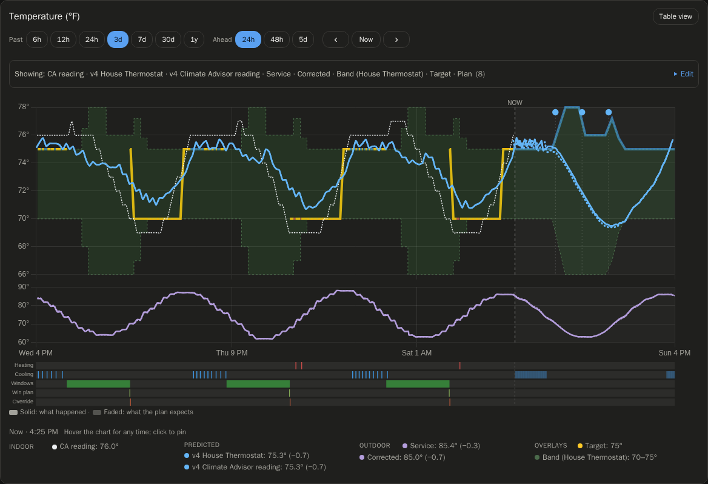
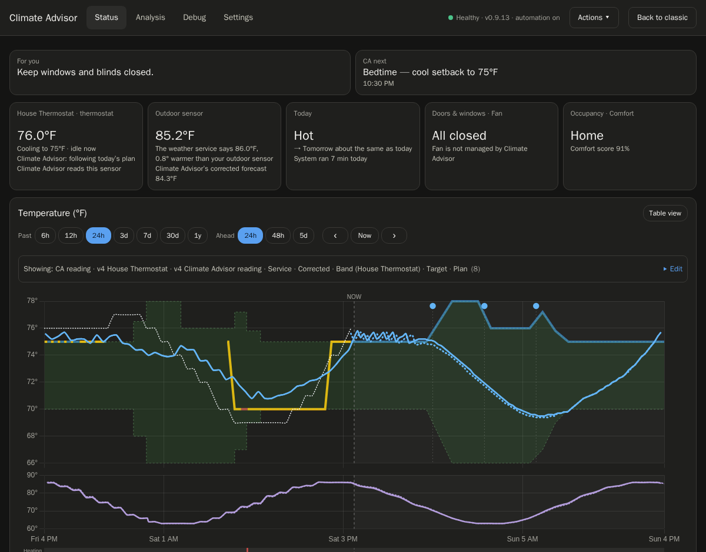
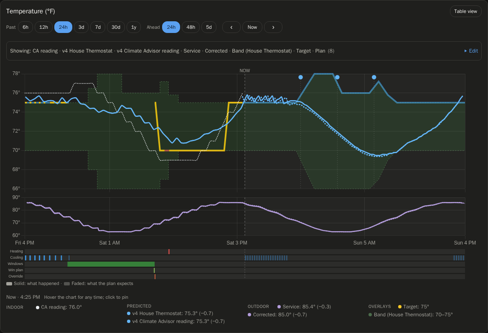
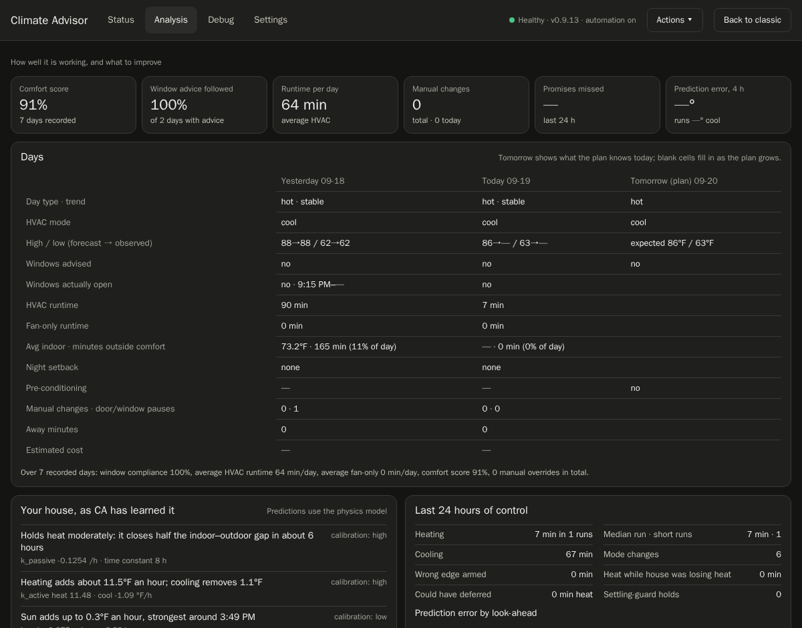

# Climate Advisor for Home Assistant

A Home Assistant integration that runs your thermostat from the weather forecast, your schedule, occupancy and your door/window sensors, so the house stays comfortable without wasted heating or cooling. It learns how your home and thermostat behave over time.

**Requires Home Assistant 2026.3 or newer.** Available in the [HACS](https://hacs.xyz) default store.

| Temperature Forecast | Current Status |
|---|---|
|  |  |

| 24-hour View | Analysis |
|---|---|
|  |  |

## What it does

- **Plans each day from the forecast.** Each morning it classifies the day (hot / warm / mild / cool / cold) and the trend into tomorrow, then sends a short briefing with what it will do and what you can do (open or close windows).
- **Holds a comfort band, not a schedule of writes.** It sets one heat or cool setpoint at the edge of your comfort range and lets the thermostat hold it. It switches between heat and cool as the house moves, and adjusts at wake-up, bedtime and when you leave or return.
- **Respects your changes.** A change you make at the thermostat is kept for a grace period (30 min by default) before Climate Advisor resumes its plan.
- **Handles doors and windows.** Once a door or window has been open past its delay (10 min by default), heating and cooling pause (or ventilation starts, see below). They resume when it closes. A sensor that stops reporting holds the pause rather than counting as closed.
- **Uses outside air.** When outdoor air helps, it runs natural ventilation through a whole-house fan or the thermostat's blower instead of the AC.
- **Optional extras:**
  - a bedroom sensor at night (see below);
  - away / vacation / guest occupancy toggles;
  - time-of-use pre-conditioning ahead of high-cost periods;
  - an optional Claude-powered AI Investigator.
- **Learns.** A physics-based thermal model learns your home's heating, cooling, insulation, ventilation and solar response. It also learns your thermostat's own swing, and after two weeks of data it starts offering suggestions.
- **Watches itself.** It warns you when the thermostat, weather source or a sensor stops responding. It also checks its own behaviour against a set of household promises (for example, "never undo your manual change early"); any misses show in the Analysis tab and in the diagnostics.
- **Observe-only mode.** Turn the automation switch off and Climate Advisor keeps planning and reporting but sends no commands.

### Household rules

Rules 1 and 2 apply only with a whole-house fan. Rule 3 applies to every home with door/window sensors.

1. The whole-house fan never runs in a sealed house. With every door and window closed, it is stopped within 30 seconds, however it was turned on.
2. The whole-house fan and the heat/AC never run together, and your newest action wins. If both are ever found running, one of them is stopped within about 10 seconds, whatever the button timing.
3. No heating or cooling into a window open past its delay, unless you turned it on yourself.

A whole-house fan therefore **needs at least one door/window sensor**. Without one, setup warns you, and that configuration is not supported.

### Day types

| Day | Today's high (default) | Climate Advisor | You |
|---|---|---|---|
| Hot | 85°F+ | Cools, pre-cools overnight when it helps | Keep the house sealed, close blinds |
| Warm | 75–84°F | Holds the comfort band; ventilates when outside air helps | Open windows in the morning, close them when it warms |
| Mild | 60–74°F | Holds the comfort band | Open windows when the briefing says they help |
| Cool | 45–59°F | Heats | Keep closed |
| Cold | below 45°F | Heats, pre-heats ahead of colder days | Keep sealed |

The thresholds are adjustable. A trend of 5°F or more into tomorrow adjusts the overnight setback and pre-heating; 10°F or more adjusts them further.

### Fans

- **Fan mode:** disabled, whole-house fan, or HVAC fan (the thermostat's blower).
- **Whole-house fan:**
  - A separate state entity (`fan_state_entity`) can report the fan's real on/off state. With `fan_state_feedback` off (the default), Climate Advisor can't see the fan.
  - The optional QuietCool RF remote integration honours the wall remote's timer presses. It needs the [`gunkl/quietcool-house-fan`](https://github.com/gunkl/quietcool-house-fan) firmware; see [fan-remote-spec](docs/fan-remote-spec.md).

### Bedroom sensor at night

Set a **Sleep Indoor Temp Sensor** to keep the bedroom, not the hallway, on target while the sleep schedule is active. Climate Advisor raises the hallway setpoint a step at a time, at most 4°F (2°C) past your sleep temperature, so the furnace or AC actually runs for the bedroom. It steps back down once the bedroom is on target. The Status card and the chart show the extra degrees. Cooling works the same way but has only been tested in simulation.

## Installation

**HACS (recommended):** search for "Climate Advisor" in HACS, install it, and restart Home Assistant. Then go to **Settings → Devices & Services → Add Integration → Climate Advisor**.

**Manual:** copy `custom_components/climate_advisor` into `config/custom_components/`, restart, then add the integration as above.

## Setup

The setup wizard asks for:

1. **Core:** weather entity, climate entity and notification service.
2. **Unit:** °F or °C. This applies to every displayed value and input.
3. **Setpoints:** comfort and setback for heat and cool, plus optional sleep heat and sleep cool.
4. **Temperature sources:** indoor and outdoor, from the weather service, a sensor, an input number or the thermostat (indoor only).
5. **Doors/windows and fan:**
   - door/window sensors, their polarity and the open delay;
   - fan mode and fan entities.
6. **Occupancy:** optional home/away, vacation and guest toggles, each with a polarity setting.
7. **Schedule:**
   - zone name;
   - wake time (default 06:30), bedtime (22:30) and briefing time (06:00).

Everything is editable afterwards under **Configure**. The options there also cover:
- time-of-use schedules;
- notifications;
- advanced options, such as **Prefer Savings Over Comfort** and the natural-ventilation soft start;
- day-type thresholds;
- AI settings (needs a Claude API key);
- GitHub settings, for submitting reports as issues.

### Thermostat requirements

Climate Advisor is the scheduler and the thermostat is the executor. Set the thermostat so it keeps Climate Advisor's commands:

- **Turn off built-in schedules and "smart" home/away features.** On an Ecobee, for example, turn off Smart Recovery.
- **Set holds to last until changed.** On an Ecobee: Hold Action → Until I change it.
- **Single-mode systems:** heat-only and cool-only thermostats work, with Climate Advisor using the one mode the device has. These setups are less tested than heat-and-cool systems.

### Multiple zones

Each thermostat is its own zone: a separate config entry with its own learning, thermal model, dashboard data and settings. Nothing is shared between zones.

To add a zone, run **Add Integration → Climate Advisor** again for the next thermostat. With two or more zones:
- the dashboard shows a zone selector;
- every service asks which zone it applies to.

See [multi-zone-spec](docs/multi-zone-spec.md).

## Entities

Each zone creates **19 sensors** and **1 switch**, grouped under a device named after the zone. Entity IDs come from the zone name, for example `sensor.living_room_day_type`. Existing entities keep the IDs they were created with.

| Entity | What it shows |
|---|---|
| Day Type, Trend | Today's classification and the trend into tomorrow |
| Daily Briefing | Today's briefing summary; the full text is in the attributes |
| Your Next Action | What you can do next, such as opening or closing windows |
| Next Automation Action, Next Automation Time | What Climate Advisor does next, and when |
| Status | Active, grace, override or paused |
| Target Temperature | The temperature the house is aiming for right now |
| Comfort Score | How much of the time the house stayed in range |
| Occupancy Mode | Home, away, vacation or guest |
| Last Action Time, Last Action Reason | The last thermostat change and why |
| Fan Status | Fan state, such as active, manual override or inactive |
| Contact Sensors | Door/window summary, with per-sensor detail |
| Indoor Temperature, Outdoor Temperature, Forecast High, Forecast Low | Current readings and today's forecast |
| AI Status | AI feature state, usage and cost |
| **Automation** (switch) | Off means observe-only: no commands are sent |

## Services

Every service takes a **Zone** (`entry_id`), which you pick from the dropdown in the service-call UI.

| Service | Purpose |
|---|---|
| `climate_advisor.respond_to_suggestion` | Accept or dismiss a learning suggestion (`action`, `suggestion_key`) |
| `climate_advisor.force_reclassify` | Fetch the forecast again and reclassify today |
| `climate_advisor.resend_briefing` | Rebuild and resend today's briefing |
| `climate_advisor.dump_diagnostics` | Write a diagnostic snapshot to the HA log |
| `climate_advisor.reset_learning_data` | Reset learned data (`scope`: `all`, `thermal_model`, `weather_bias` or `suggestions`). This can't be undone |

## Dashboard

A sidebar panel with four tabs:

- **Status:** today's strategy, the temperature forecast chart, current conditions, HVAC, fan and door/window state, and quick actions.
- **Analysis:** the Activity Record (deterministic, no AI), the optional AI Investigator, classification details, the compliance summary and learning suggestions. You can copy a report, download it or submit it as a GitHub issue.
- **Settings:** a read-only view of the configuration.
- **Debug:** automation state, the prediction engines, tomorrow's plan, the daily record and manual actions (reclassify, resend the briefing, diagnostics).

The panel is backed by a REST API; see [rest-api](docs/rest-api.md).

## Documentation

| Topic | Doc |
|---|---|
| Start here (index of every spec) | [00-PROJECT-INSTRUCTIONS](docs/00-PROJECT-INSTRUCTIONS.md) |
| Strategy and design | [01-STRATEGY-AND-DESIGN](docs/01-STRATEGY-AND-DESIGN.md) |
| Architecture | [02-ARCHITECTURE-REFERENCE](docs/02-ARCHITECTURE-REFERENCE.md) |
| How decisions are computed | [08-COMPUTATION-REFERENCE](docs/08-COMPUTATION-REFERENCE.md) |
| Troubleshooting | [09-DEBUGGING-GUIDE](docs/09-DEBUGGING-GUIDE.md) |
| Thermal model | [thermal-model-v3-spec](docs/thermal-model-v3-spec.md) |
| AI features | [ai-integration](docs/ai-integration.md) |
| Release history | [CHANGELOG](CHANGELOG.md) |

## Contributing

Fork the repository, create a branch and open a pull request. [DEVELOPMENT.md](docs/DEVELOPMENT.md) covers the environment, the unit and real-Home-Assistant test tiers (`python scripts/test.py unit` / `ha`) and the simulator. The roadmap is tracked in [Issue #11](https://github.com/gunkl/ClimateAdvisor/issues/11).

## License

MIT
